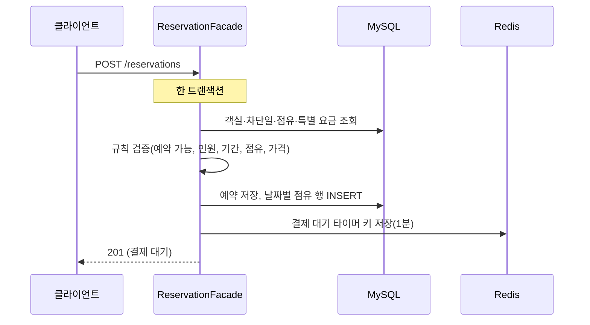
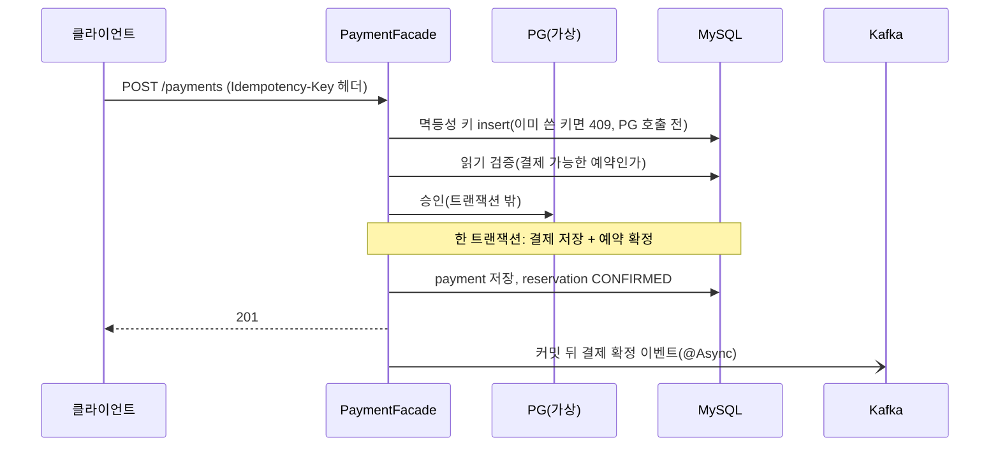
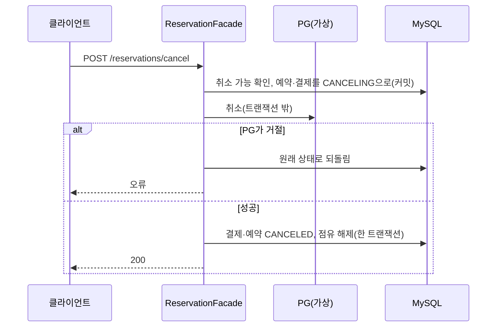
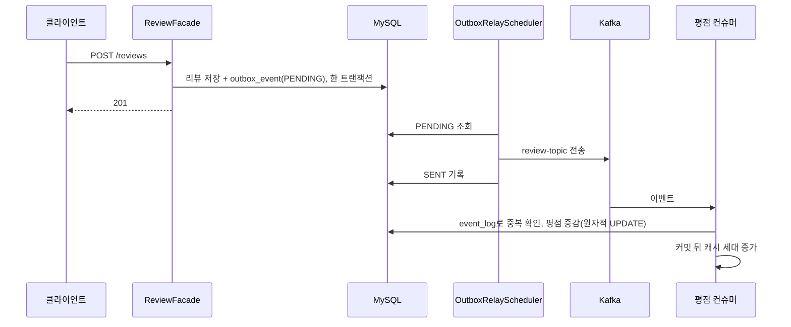

# 아키텍처

시스템이 무엇으로 이루어져 있고 어떻게 연결되는지를 한눈에 보여 주는 문서다. 2026-11-17 코드 기준이다.
코드를 어디에 두는지, 레이어 규칙은 [architecture-guide.md](architecture-guide.md)에 있고, 테이블 구조는 [erd.md](erd.md)에 있다.

## 1. 시스템 경계

```mermaid
flowchart LR
    client["클라이언트<br/>(웹·앱, 이 프로젝트 밖)"]
    admin["관리자 기능<br/>(숙소·객실·이미지·특별 요금·차단일 등록)<br/>범위 밖"]
    subgraph system["예약의 정석 (Spring Boot API 서버)"]
        api["REST API<br/>인증·예약·결제·조회·리뷰"]
    end
    mysql[("MySQL<br/>주 저장소")]
    redis[("Redis<br/>캐시·락·토큰")]
    kafka[["Kafka<br/>이벤트"]]
    pg["PG (가상)<br/>MockPgClient"]
    notify["알림 채널<br/>(자리만 있음)"]

    client -->|HTTPS JSON| api
    admin -.->|데이터 등록(가정)| mysql
    api --> mysql
    api --> redis
    api -->|이벤트 발행| kafka
    kafka -->|이벤트 소비| api
    api -->|승인·취소| pg
    api -.-> notify
```

- **범위 밖**: 숙소·객실·이미지·특별 요금·차단일을 등록하는 관리자 기능은 이 시스템에 없다. 별도 관리자 API가 있다고 가정하고, 이 프로젝트는 조회·예약·결제·동시성 같은 핵심 로직에 집중한다. 테스트에서는 Fixture가 이 데이터를 직접 저장한다.
- **PG는 가상**이다. `PgClient` 인터페이스에 운영용 `MockPgClient`(지연과 무작위 실패)가 있고, 테스트는 `FakePgClient`로 바꾼다. 결제 취소 결과를 조회하는 API는 없다.
- **알림**은 지금 발송 코드가 없고 소비자 안에 주석 자리만 있다.

## 2. 구성 요소와 역할

| 구성 요소 | 하는 일 |
|---|---|
| MySQL | 회원, 숙소, 객실, 예약, 날짜별 점유(`reservation_night`), 결제, 리뷰, `event_log`(소비 멱등), `outbox_event`를 저장한다 |
| Redis | JWT 리프레시 토큰과 액세스 토큰 블랙리스트, 숙소 상세·리뷰 첫 페이지 캐시와 캐시 세대 키, 숙소 존재 확인용 블룸 필터, 결제 대기 타이머 키(만료 이벤트), Redisson 분산 락 |
| Kafka | `payment-topic`(결제 확정 후처리), `review-topic`(리뷰 등록·삭제에 따른 숙소 평점 갱신). 컨슈머는 `@RetryableTopic`으로 재시도하고 `.dlt`로 보낸다 |
| API 서버 | 위 저장소와 PG를 엮어 요청을 처리하고 Kafka 이벤트를 발행·소비한다. 서버 한 앱이 생산자와 소비자를 겸한다 |

## 3. 앱 내부 구조

도메인(`member`, `accommodation`, `room`, `reservation`, `payment`, `review`, 공통 `common`)별로 패키지를 나누고, 요청은 다음 층을 따라 흐른다.

```
Controller / Listener / Scheduler / Consumer   ← 진입점
        ↓
      Facade      여러 Service 조율, 트랜잭션 경계
        ↓
      Service     한 도메인의 흐름
        ↓
    Repository
(엔티티·VO: 도메인 규칙)
```

- 진입점은 모두 Facade만 호출한다. 진입점은 Controller, 이벤트 리스너, Kafka 컨슈머, Redis 만료 리스너, Outbox 릴레이 스케줄러다.
- 모든 API는 Facade가 `Info`를 반환하고 Controller가 `Response`로 바꾼다.
- 자세한 규칙(의존 방향, 트랜잭션, 이벤트)은 [architecture-guide.md](architecture-guide.md)를 따른다.

## 4. 핵심 흐름

### 4.1 예약 생성

- 같은 객실 같은 밤의 이중 예약은 `(room_id, stay_date)` 유니크가 막는다. 동시 요청 중 진 쪽은 409 `RESERVE_003`이다.

### 4.2 결제

- 승인 뒤 DB 단계가 실패하면 PG에 보상 취소를 보낸다(보상은 PG 취소 하나다).
- 결제 요청은 `Idempotency-Key` 헤더 값을 PG 호출 전에 insert해서 같은 키의 재전송을 거른다(이미 쓴 키면 409). 실패해도 키는 남으므로 클라이언트는 새 키로 다시 시도한다.
- 예약 id 기준 분산 락과 예약 상태 검사가 키가 다른 중복 요청을 막는다.

### 4.3 예약 취소

- 확정 단계가 실패하면 `CANCELING`으로 남고 자동 복구는 없다(수동 확인).

### 4.4 리뷰와 숙소 평점 (Outbox)

- 이벤트는 적어도 한 번 전달된다. 중복은 소비 쪽 `event_log`가 막는다.

### 4.5 결제 대기 만료
- 예약을 만들 때 Redis에 결제 대기 타이머 키를 둔다. 키가 만료되면 `ReservationTimeoutListener`가 `ReservationFacade.expire`를 호출해 예약을 `EXPIRED`로 바꾸고 점유한 밤을 푼다.
- Redis 만료 이벤트는 유실될 수 있어서 DB 기준 폴링으로 바꿀 계획이다.

## 5. 정합성과 동시성 장치

| 문제 | 장치 |
|---|---|
| 같은 객실 같은 밤의 이중 예약 | `reservation_night`의 `(room_id, stay_date)` 유니크(락 없이 DB 제약이 최종 판정) |
| 결제 중복 요청 | `Idempotency-Key` insert(같은 키는 PG 호출 전에 거절) + 예약 id 기준 Redisson 분산 락 + 상태 검증 |
| 취소 중복 요청 | 예약 id 기준 Redisson 분산 락 + 상태 검증 |
| PG 승인 뒤 DB 실패 | 보상 취소(PG 취소) |
| PG 취소 뒤 DB 실패 | `CANCELING` 상태로 남겨 흔적을 둔다(수동 확인) |
| 이벤트 유실(리뷰 → 평점) | Outbox |
| 이벤트 중복 수신 | `event_log`의 `event_id` 유니크 |
| 숙소 상세·리뷰 캐시 정합성 | 캐시 키에 세대를 넣고 평점이 바뀌면 커밋 뒤 세대를 올린다 |
| 캐시가 비는 순간의 요청 몰림 | 캐시 갱신 락과 더블 체크 |
| 존재하지 않는 숙소 id 조회 | 블룸 필터 + DB 확인 |
| 날짜별 요금 | `room_special_price`(없는 날은 기본 요금), 예약 시점 가격은 `reservation_night.price`에 스냅샷 |

## 6. 현재 한계
- 결제 대기 만료는 Redis 키 만료 이벤트에 의존한다(유실 가능). DB 기준 폴링으로 바꿀 예정이다.
- `CANCELING`으로 멈춘 취소와 Outbox의 `PENDING` 적체를 자동으로 복구하거나 알려 주는 장치가 없다.
- 가상 PG에는 결제·취소 결과 조회 API가 없다. PG 타임아웃과 거절을 구분하지 못한다.
- 배포, CI, 모니터링은 아직 없다.
