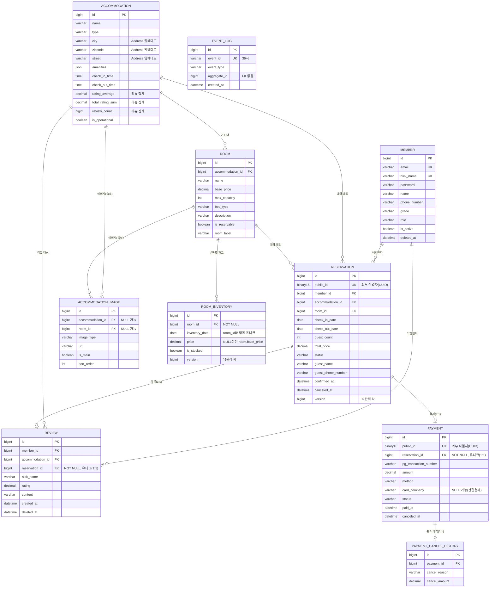

# ERD (현재 엔티티 기준)

엔티티(JPA)의 테이블 구조와 관계를 Mermaid로 그린 것이다. 엔티티 구조가 바뀌면 이 문서를 함께 갱신한다([CLAUDE.md](../CLAUDE.md) 참고).

- 기준: `main`이 아니라 `develop`의 엔티티. 마지막 갱신: 2026-11-06 (`Reservation`, `Payment`에 `public_id` 추가, ADR 0012).
- 공통: `BaseEntity`를 상속한 테이블은 `created_at`, `updated_at`을 갖는다(아래 그림에서는 생략).
- `PK` 기본키, `FK` 외래키, `UK` 유니크. 따옴표 안은 설명이다.

## 관계 메모

- 재고(`ROOM_INVENTORY`)는 객실에 종속되고 `(room_id, inventory_date)`가 유니크다. 예약은 재고를 가리키는 FK 없이 `room_id`와 `check_in_date`~`check_out_date`로 해당 날짜의 재고를 찾는다.
- `EVENT_LOG.aggregate_id`는 FK가 없는 `Long`이다(멱등성 확인에 쓰는 이벤트 기록).
- `PAYMENT`와 `PAYMENT_CANCEL_HISTORY`는 현재 1:1이다.
