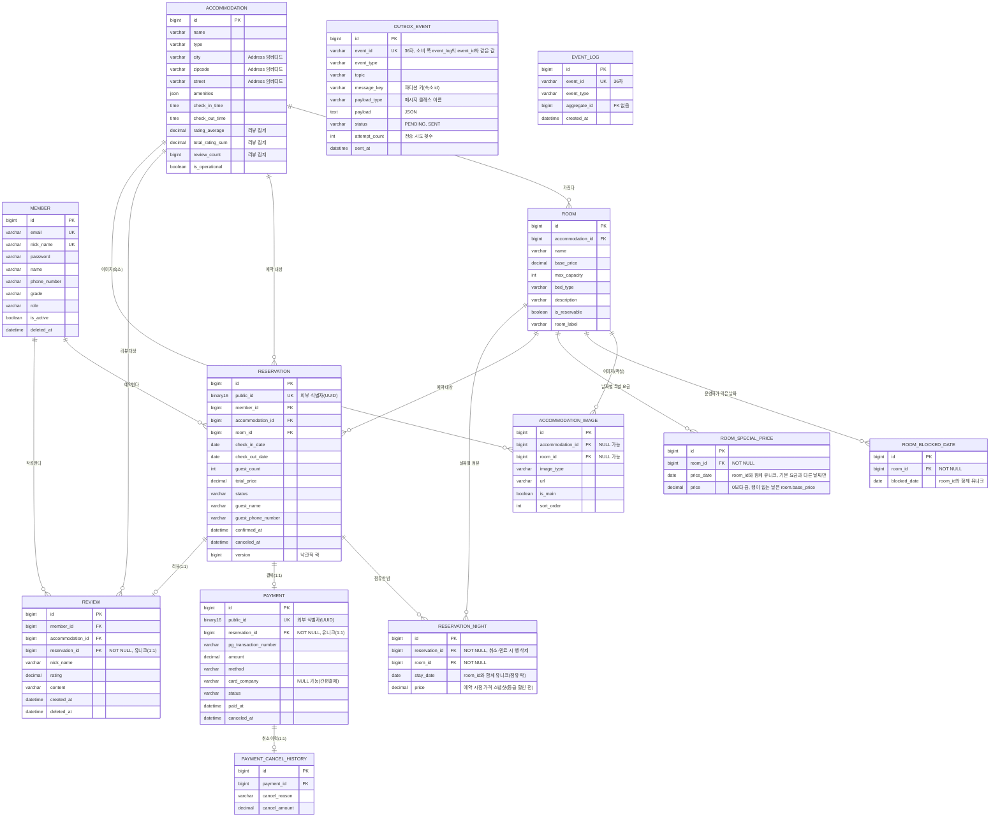

# ERD (현재 엔티티 기준)

엔티티(JPA)의 테이블 구조와 관계를 Mermaid로 그린 것이다. 엔티티 구조가 바뀌면 이 문서를 함께 갱신한다([CLAUDE.md](../CLAUDE.md) 참고).

- 기준: `main`이 아니라 `develop`의 엔티티. 마지막 갱신: 2026-11-17 (`OUTBOX_EVENT` 추가, ADR 0017). 이전: 2026-11-16 (`ROOM_INVENTORY` 제거, `RESERVATION_NIGHT`·`ROOM_BLOCKED_DATE` 추가, ADR 0013 사이클 3~4). 이전: 2026-11-16 (`ROOM_SPECIAL_PRICE` 추가, ADR 0013 사이클 2). 이전: 2026-11-06 (`Reservation`, `Payment`에 `public_id` 추가, ADR 0012).
- 공통: `BaseEntity`를 상속한 테이블은 `created_at`, `updated_at`을 갖는다(아래 그림에서는 생략).
- `PK` 기본키, `FK` 외래키, `UK` 유니크. 따옴표 안은 설명이다.

## 관계 메모

- 점유(`RESERVATION_NIGHT`)는 예약이 차지한 밤마다 한 행이고 `(room_id, stay_date)`가 유니크라서 같은 객실 같은 밤의 이중 예약을 DB가 막는다. 예약이 취소·만료되면 행을 지우고, 확정·이용 완료 예약의 행은 남긴다. 운영자가 막은 날짜는 `ROOM_BLOCKED_DATE`에 따로 둔다(ADR 0013).
- 날짜별 가격은 `ROOM_SPECIAL_PRICE`의 특별 요금 행만 두고, 행이 없는 날은 `ROOM.base_price`다. 합계와 평균은 `Room.calculateStayPrice`가 계산한다(ADR 0013, 0014).
- `EVENT_LOG.aggregate_id`는 FK가 없는 `Long`이다(멱등성 확인에 쓰는 이벤트 기록).
- `PAYMENT`와 `PAYMENT_CANCEL_HISTORY`는 현재 1:1이다.
- `OUTBOX_EVENT`는 반드시 Kafka로 전달되어야 하는 이벤트(지금은 리뷰 등록·삭제)를 본 작업과 같은 트랜잭션에 기록하는 행이다. FK는 없다. 스케줄러가 `PENDING` 행을 Kafka로 보내고 `SENT`로 바꾼다(ADR 0017).
